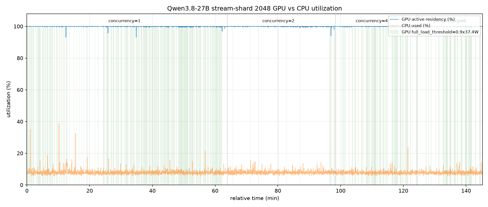

# Qwen3.8-27B 2048 stream-shard：GPU/CPU 利用率与 full_load 分析

> run: `qwen38-27b-20261126-092930`
> power_ceiling_w = 37.4W（本机 MLX 压测 10s 滚动最大）
> full_load = GPU active residency >= 95% 且 GPU power >= 0.9 * 37.4W

## 分阶段统计

| 并发 | 样本数 | GPU usage median | GPU usage p95 | CPU usage median | CPU usage p95 | busy_fraction | full_load_fraction |
|---|---:|---:|---:|---:|---:|---:|---:|
| 1 | 1643 | 100.0% | 100.0% | 7.7% | 9.9% | 99.9% | 43.9% |
| 2 | 861 | 100.0% | 100.0% | 7.8% | 10.0% | 100.0% | 1.0% |
| 4 | 616 | 100.0% | 100.0% | 7.6% | 9.5% | 100.0% | 24.4% |
| 8 | 550 | 100.0% | 100.0% | 7.6% | 9.5% | 100.0% | 19.8% |

## 图

